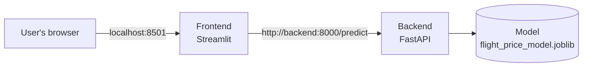

# ✈️ Flight Price Prediction

A machine learning web app that estimates the price of a domestic flight in India, built as a **multi-container application with Docker Compose**.

A user fills in the flight details (airline, route, class, stops, departure and arrival time slots, duration, days before departure) in a **Streamlit** interface. The frontend sends them to a **FastAPI** backend, which runs a **scikit-learn** model and returns the estimated price.


---

## Features

- 🧠 Price prediction with a trained scikit-learn model
- ⚡ REST API built with FastAPI, with a `/health` endpoint used by Docker healthchecks
- 🖥️ Simple web interface built with Streamlit
- 🐳 Fully containerized: one command to build and run everything
- 🔁 Hot reload in development, with VS Code Dev Containers for both services
- 📦 Fast, reproducible Python dependency management with [uv](https://docs.astral.sh/uv/)

## Tech stack

| Layer | Tools |
|---|---|
| Machine learning | scikit-learn, pandas, joblib |
| Backend (API) | FastAPI, Pydantic, Uvicorn |
| Frontend (UI) | Streamlit, Requests |
| Containers | Docker (multi-stage build), Docker Compose, Dev Containers |
| Python tooling | uv, Python 3.13 |

## Architecture



- Both services run in their own container and communicate over the internal network that Docker Compose creates. The frontend reaches the API using the service name `backend` as hostname.
- Only the frontend is exposed to the host (port `8501`). The API stays internal.
- The frontend waits for the backend to be **healthy** (`depends_on: condition: service_healthy`) before starting.
- The model is mounted into the backend container as a volume, so it can be replaced without rebuilding the image.

## Project structure

```
flight-price-prediction/
├── .devcontainer/
│   ├── backend/devcontainer.json    # Dev Container for the API
│   └── frontend/devcontainer.json   # Dev Container for the UI
├── artifacts/                       # Trained model goes here (not versioned)
├── backend/
│   ├── main.py                      # FastAPI app: /health and /predict
│   ├── pyproject.toml
│   └── uv.lock
├── frontend/
│   ├── main.py                      # Streamlit app
│   ├── pyproject.toml
│   └── uv.lock
├── Dockerfile                       # Multi-stage: shared base, backend and frontend targets
├── docker-compose.yml
└── .dockerignore
```

## Getting started

### Prerequisites

- [Docker](https://docs.docker.com/get-docker/) with Docker Compose
- The trained model file (see below)

### 1. Clone the repository

```bash
git clone https://github.com/Josue-Ngoula/flight-price-prediction.git
cd flight-price-prediction
```

### 2. Add the model

The trained model is too large to be stored on GitHub. Place it in the `artifacts/` folder:

```
artifacts/flight_price_model.joblib
```

<!-- TODO: explain how to get the model (download link, or training script/notebook to run) -->

### 3. Build and run

```bash
docker compose up --build
```

Then open **http://localhost:8501**.

To stop everything:

```bash
docker compose down
```

### Exploring the API (optional)

The API is not exposed to the host by default. To open its interactive documentation, add a port mapping to the `backend` service in `docker-compose.yml`:

```yaml
    ports:
      - "8000:8000"
```

Then open **http://localhost:8000/docs**.

## Development with Dev Containers

Each service can be opened directly inside its container with VS Code:

1. Install the **Dev Containers** extension.
2. `Ctrl+Shift+P` → **Dev Containers: Reopen in Container**.
3. Choose **Backend (Hot Reload)** or **Frontend (Hot Reload)**.

The source code is mounted into the containers, so changes are applied immediately: Uvicorn reloads the API, and Streamlit refreshes the page on save.

## The model

<!-- TODO: fill in with your own details -->
- **Dataset:** <!-- e.g. "Flight Price Prediction" dataset from Kaggle (link) -->
- **Algorithm:** <!-- e.g. RandomForestRegressor -->
- **Features:** airline, source city, destination city, class, number of stops, departure and arrival time slots, duration, days left before departure
- **Performance:** <!-- e.g. R² = 0.98, MAE = ... on the test set -->

## Docker concepts practiced

This project was built to learn Docker in a realistic setting:

- Multi-stage builds with a shared base image and one target per service
- Layer caching: dependencies are installed before the source code is copied
- Pinned Python version with uv for reproducible builds
- `.dockerignore` to keep the build context small
- Service-to-service networking with Docker Compose
- Healthchecks and startup ordering with `depends_on`
- Bind mounts for hot reload, with an anonymous volume to preserve the container's virtual environment
- VS Code Dev Containers for a consistent development environment

## Possible improvements

- Add the training notebook or script to the repository
- Reduce the model size (compression or a lighter algorithm)
- Add tests and a GitHub Actions workflow to build the images
- Deploy the app to the cloud

## Author

**Josué Ngoula**: [GitHub](https://github.com/Josue-Ngoula)
